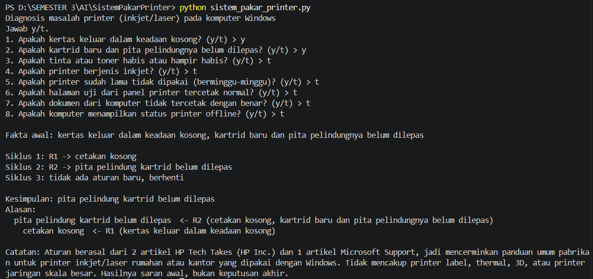
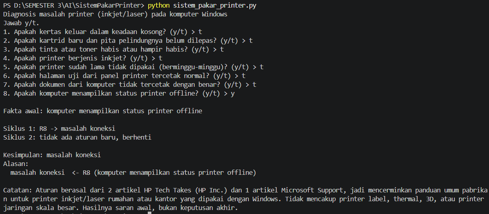
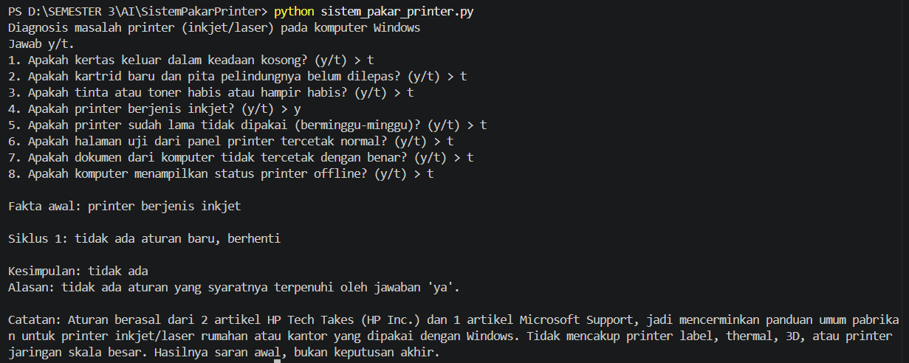

# Tugas 5 - Sistem Pakar Sederhana: Diagnosis Masalah Printer

**Nama:** L. M. Munajin Romdhoni
**NIM:** F1D02510118
**Mata kuliah:** Kecerdasan Buatan (MKL1303131) - Teknik Informatika UNRAM

## 1. Topik dan Cara Menjalankan

Topik: diagnosis masalah printer (inkjet/laser) yang dipakai dengan komputer Windows, meliputi cetakan kosong, masalah koneksi/offline, serta antrean dan driver.

- Bahasa: Python 3 (diuji pada Python 3.10 ke atas), tanpa library tambahan.
- Berkas: `sistem_pakar_printer.py` (mesin FC + antarmuka), `kb_printer.json` (aturan dan sumber).
- Perintah (jalankan dari folder repository):

```
python sistem_pakar_printer.py
```

Jawab pertanyaan dengan `y` atau `t`.

## 2. Sumber dan Tabel Aturan

| ID | Sumber |
| -- | ------ |
| S1 | Jon Shih. *How to Troubleshoot a Printer That's Printing Blank Pages*. HP Tech Takes (HP Inc.), 5 Maret 2026. https://www.hp.com/us-en/tech-takes/printers/troubleshooting/printer-printing-blank-pages-fix.html. Diakses 13 November 2026. |
| S2 | Oluwakemi Oladapo. *Printer Troubleshooting FAQs: Quick Fixes for the Most Common Printing Problems*. HP Tech Takes (HP Inc.), 23 Februari 2026. https://www.hp.com/us-en/tech-takes/printers/troubleshooting/printer-troubleshooting-common-problems-quick-fixes.html. Diakses 13 November 2026. |
| S3 | Microsoft Support. *Troubleshooting offline printer problems in Windows*. Microsoft Corporation, 2026. https://support.microsoft.com/en-us/windows/hardware/printer/troubleshooting-offline-printer-problems-in-windows. Diakses 13 November 2026. |

Aturan di `kb_printer.json` adalah parafrasa Indonesia dari ketiga sumber, bukan kutipan.

| Aturan | IF | THEN | Sumber |
| ------ | -- | ---- | ------ |
| R1 | kertas keluar kosong | cetakan kosong | S1 |
| R2 | cetakan kosong **AND** kartrid baru, pita pelindung belum dilepas | pita pelindung kartrid belum dilepas | S1 |
| R3 | cetakan kosong **AND** tinta/toner habis atau hampir habis | tinta atau toner kurang | S1 |
| R4 | cetakan kosong **AND** printer inkjet **AND** printer sudah lama tidak dipakai | printhead tersumbat | S1 |
| R5 | halaman uji dari panel printer normal **AND** dokumen dari komputer tidak tercetak benar | masalah perangkat lunak | S2 |
| R6 | masalah perangkat lunak **AND** cetakan kosong | driver printer usang atau rusak | S1 |
| R7 | masalah perangkat lunak | antrean cetak atau aplikasi bermasalah | S3 |
| R8 | komputer menampilkan printer offline | masalah koneksi | S3 |

Rantai aturan: R1 -> R2/R3/R4/R6, dan R5 -> R6/R7. Kesimpulan akhir (6 buah) adalah hasil aturan yang tidak dipakai sebagai syarat aturan lain: pita pelindung kartrid belum dilepas, tinta atau toner kurang, printhead tersumbat, driver printer usang atau rusak, antrean cetak atau aplikasi bermasalah, dan masalah koneksi.

## 3. Metode: Forward Chaining

Dipilih karena pengguna printer umumnya tahu gejala (fakta) lebih dulu, bukan penyebabnya, sehingga alur dari fakta menuju kesimpulan paling alami. FC juga mudah menunjukkan rantai alasan (R1 -> R2, dan seterusnya).

Langkah:

```
memori <- fakta yang dijawab "ya" oleh user
ULANGI:
    cocok <- aturan yang syaratnya terpenuhi oleh memori DAN hasilnya belum ada di memori
    JIKA cocok kosong: BERHENTI
    r <- cocok[0]
    tambahkan r.maka ke memori
    catat bahwa r.maka berasal dari r
```

Mode `dan`: semua syarat harus ada di memori. Mode `atau`: salah satu cukup. Aturan yang hasilnya sudah ada tidak dijalankan lagi supaya program berhenti.

## 4. Tiga Kasus Uji (dan tambahan)

Nomor jawaban "ya" mengikuti urutan pertanyaan di program.

| # | Jawaban "ya" | Kesimpulan |
| - | ------------ | ---------- |
| 1 | 1 (kertas kosong), 2 (pita pelindung belum dilepas) | pita pelindung kartrid belum dilepas |
| 2 | 8 (printer offline) | masalah koneksi |
| 3 | 4 (printer inkjet) saja | **tidak ada** (kasus negatif) |

Screenshot (simpan di folder `screenshot/`):





## 5. Batas Keberlakuan

Pengetahuan dalam program ini berasal dari dua artikel HP Tech Takes (HP Inc.) dan satu artikel Microsoft Support, sehingga mencerminkan panduan umum pabrikan untuk printer inkjet dan laser rumahan atau kantor yang dipakai dengan Windows. Program tidak mencakup printer label, thermal, 3D, atau printer jaringan skala besar, dan tidak menggantikan diagnosis teknisi. Hasilnya saran awal, bukan keputusan akhir. Batas ini juga ditampilkan di akhir keluaran program.

## 6. Penggunaan Alat Bantu AI

Claude (Anthropic) dipakai untuk membantu mencari dan membaca sumber, menyusun draf aturan, kode, dan README. [EDIT bagian ini sesuai yang benar-benar kamu lakukan, dan pastikan kamu bisa menjelaskan kode serta aturannya.]
